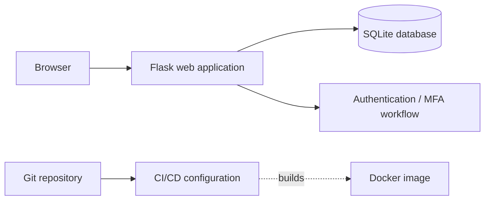

# EXAM.APP — Python/Flask Application, Docker & CI/CD

**Project type:** Independent application development and DevOps learning project  
**Technologies:** Python 3.12 · Flask · SQLite · HTML/CSS · Git · Bitbucket · Docker · Bitbucket Pipelines · Ubuntu Linux

## Goal

Build and improve a web-based examination application while practicing the full engineering workflow: application functionality, authentication, container packaging, repository-based changes, pipeline configuration, and troubleshooting during deployment.

## Hands-on work

- Developed and debugged functionality around **user login, account flows, quiz/exam interactions, result processing, and MFA/one-time-password workflows**.
- Used **Flask** with a **SQLite** database and web templates; investigated application errors such as missing templates, import errors, HTTP endpoint mismatches, and authentication failures.
- Built a **Docker image** using a Python 3.12 slim base and ran the Flask app in a container in a lab environment.
- Worked with **Git/Bitbucket** and edited **Bitbucket Pipelines YAML**, including troubleshooting YAML/merge conflicts and organizing build/test stages.
- Tested application access and analyzed HTTP connectivity, origin configuration, and request timeouts when using a reverse-tunnel setup in the lab.

## Illustrative architecture

*This is a simplified overview of the project components, not a claim that every CI/CD stage is fully automated in a live deployment.*

## Selected engineering challenges

**Application and route troubleshooting.** Compared registered Flask routes with client requests, investigated errors from missing templates or imports, and corrected application-level issues during iterative development.

**Authentication and asynchronous external dependencies.** Worked on an MFA/OTP mail flow and investigated slow or failed mail delivery and their impact on request timeouts. The MFA implementation should be considered a **lab/prototype workflow**, not independently audited or production-ready security.

**Containerization and repeatability.** Packaged the Python application into a Docker image and tested local container execution; used repository configuration as the starting point for repeatable build processes.

## Security perspective

- Authentication and session handling need to be treated as **security-critical**, not merely user-interface features.
- Secrets belong in a dedicated secret store or protected CI/CD variables, **not in committed YAML or Python source**.
- One-time passwords should be generated with a cryptographically secure generator, have expiration and retry limits, and **never appear in logs**.
- Runtime debug mode, email credentials, access controls, and tunnel/origin settings require hardening before any real production use.

## Next steps — proposed, not yet verified as implemented

- Add automated unit/integration tests and a reproducible deployment workflow.
- Add SAST, dependency/secret detection, container image scanning, and defined security quality gates.
- Use hardened Flask runtime configuration, secure session settings, protected secrets, and rate limiting.
- Produce an SBOM and sign/pin release artifacts where appropriate.

## Interview summary (German)

> „Ich habe eine Python-/Flask-basierte Prüfungsanwendung entwickelt, mit Docker containerisiert und die CI/CD-Konfiguration mit Bitbucket Pipelines bearbeitet. Dabei habe ich Fehler im Bereich Authentifizierung, Routing und Deployment untersucht. Besonders interessant waren die sicherheitsrelevanten Fragen rund um MFA, Credentials und automatisierte Qualitäts- und Sicherheitsprüfungen. Diese letzten Kontrollen sind auch ein wichtiger Teil meiner geplanten Weiterentwicklung des Projekts.“
