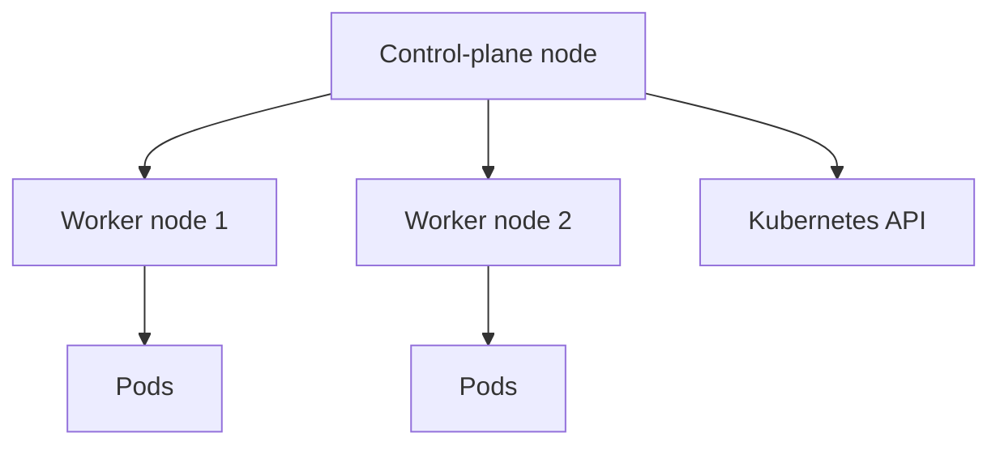

# Kubernetes Cluster Lab — Installation, Operations & Troubleshooting

**Project type:** Independent infrastructure learning lab, **not** a production Kubernetes platform  
**Technologies:** Kubernetes · kubeadm · kubectl · containerd · Ubuntu Linux · Linux networking · CNI · Bash · metrics-server

## Goal

Develop practical experience with installing and operating a multi-node Kubernetes cluster, understanding the control plane and node components, and diagnosing real failures rather than relying only on tutorials.

## Environment

- **One control-plane node** and **two worker nodes** in a Linux-based lab.
- Cluster deployed using **kubeadm**, with **containerd** as container runtime.
- Day-to-day operations and diagnostics using **kubectl**, systemd, logs, and network checks.
- Explored node metrics and cluster-component visibility with **metrics-server** and monitoring tools.

## Practical activities

- Set up and inspected the cluster node topology, node readiness, and workloads.
- Worked with core Kubernetes resources and their operational behavior: **Pods, Deployments, Services, namespaces**, and cluster-system components.
- Investigated **CNI/network plugin problems** and the impact on pod networking and component availability.
- Analyzed **metrics-server discovery failures**, `kubectl top` errors, and kubelet connectivity/timeouts (including port 10250 as a diagnostic focus).
- Investigated restart loops and compared Kubernetes events, pod logs, daemon health, and host-level service state.

## Simplified lab topology



*Logical depiction of the three-node lab; not a network security or high-availability architecture diagram.*

## Troubleshooting examples

### CNI component instability

When network plugin components did not start reliably, I used pod state, deployment/DaemonSet events, log output, and host-level checks to narrow down whether the issue concerned container runtime, cluster configuration, or networking. This was hands-on fault investigation, not an assertion that every networking issue was fully resolved.

### Metrics not available

Investigated cases where node/pod metrics were missing, with APIService health and kubelet reachability among the diagnostic checks. An unavailable metric is not automatically a dashboard problem: it can originate from the collection chain or node connectivity.

### Control-plane / service checks

Practiced distinguishing Kubernetes-level symptoms from host-level failures by checking `kubectl` resources together with `systemctl`, `journalctl`, and networking commands.

## Useful diagnostic commands

```bash
kubectl get nodes -o wide
kubectl get pods -A
kubectl describe pod POD_NAME -n NAMESPACE
kubectl logs POD_NAME -n NAMESPACE --previous
kubectl get events -A --sort-by=.lastTimestamp
kubectl get apiservices
kubectl top nodes
sudo systemctl status kubelet containerd
```

Commands are illustrative; placeholder names must be replaced with actual resource names.

## Security perspective

Cluster reliability and security are interconnected. Relevant design controls include **RBAC**, workload **securityContext**, **Pod Security Admission**, **NetworkPolicy**, restricted service accounts, controlled image sources, and audit logging. These are security concepts and proposed hardening directions; the lab description does **not** claim they are all deployed.

## Next steps — proposed, not yet verified as implemented

- Formalize RBAC roles and isolate workloads with validated NetworkPolicies.
- Introduce Pod Security Admission rules and workload securityContext defaults.
- Use declarative configuration and a controlled image update process.
- Add periodic configuration audits and a documented backup/restore exercise.

## Interview summary (German)

> „Ich habe in einer eigenen Laborumgebung einen Kubernetes-Cluster mit einem Control-Plane-Node und zwei Worker-Nodes aufgebaut. Ich habe dabei die Installation, die Cluster-Komponenten und das Troubleshooting praktisch kennengelernt. Besonders intensiv habe ich Netzwerkprobleme, fehlerhafte Pods und fehlende Metriken untersucht. Dadurch habe ich ein besseres Verständnis dafür gewonnen, wie Container-Orchestrierung, Linux-Dienste und Netzwerkkonfiguration zusammenhängen.“
