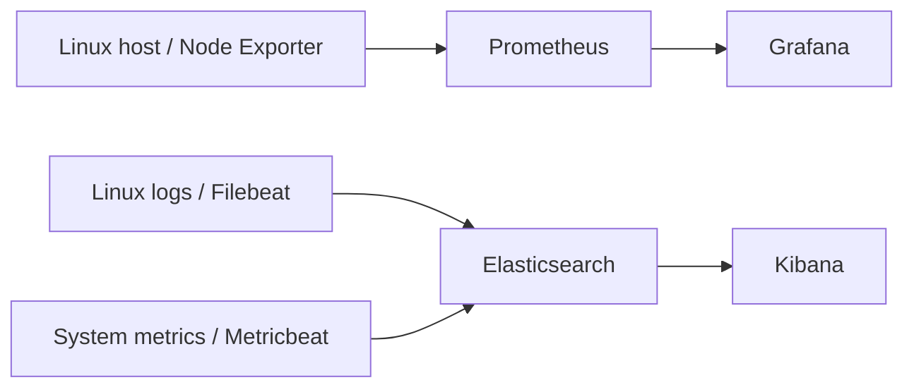

# Linux & Kubernetes Observability — Prometheus, Grafana & Elastic Stack

**Project type:** Independent monitoring/operations lab; several integrations were under active configuration and troubleshooting  
**Technologies:** Prometheus · Grafana · Node Exporter · Elasticsearch 8.x · Kibana 8.x · Filebeat · Metricbeat · Linux · systemd · Kubernetes

## Goal

Gain hands-on experience collecting, visualizing, and diagnosing system metrics and logs to support availability, performance analysis, and security-relevant operational investigations.

## Hands-on work

- Installed and configured **Prometheus**, **Grafana**, and **Node Exporter** in a Linux monitoring environment.
- Worked on scrape configurations and visualization for infrastructure metrics such as **CPU, memory, filesystem, and node status**.
- Installed and troubleshot **Elasticsearch**, **Kibana**, **Filebeat**, and **Metricbeat** as components of a centralized logging and observability environment.
- Investigated Linux service startup failures, ingest/authentication errors, configuration conflicts, unavailable metrics, and search-platform resource constraints.
- Used Linux service logs, command-line connectivity tests, and resource data to systematically narrow down root causes.

## Monitoring data paths

*Reference data paths for the tools explored. This schematic does not imply every integration or data flow was continuously healthy at the same time.*

## Selected operational incidents

**Elasticsearch startup / memory constraints.** Investigated startup failures and memory pressure, considering JVM heap configuration, system limits, process status, and service logs. This reinforced the need to size observability tooling for the available host resources.

**Beats authentication and ingest.** Encountered HTTP authentication failures and output configuration issues while integrating Beats with Elasticsearch; checked endpoints, authentication, service logs, and configuration.

**Kubernetes resource visibility.** Investigated missing node/pod metrics and looked at the collection components before treating the Grafana dashboard as the source of truth.

## Diagnostic approach

1. Verify service health and listening endpoints.
2. Check logs and error timestamps.
3. Validate connectivity and authentication independently.
4. Review metrics, disk space, and memory limits.
5. Make one controlled change, retest, and document the outcome.

## Security relevance

Centralized logs and metrics can help detect unexpected restarts, resource exhaustion, failed authentication, and anomalous behavior. **Monitoring alone is not a SIEM**: reliable security detection additionally requires event normalization, access control, retention policies, correlation rules, and alert response procedures.

## Next steps — proposed, not yet verified as implemented

- Improve standard dashboards, alerting thresholds, and runbook links.
- Secure collectors and endpoints with least-privilege credentials and encrypted transport as appropriate.
- Introduce retention, index lifecycle management, and sensible disk/memory sizing.
- Add security-relevant alert use cases and test how events would be triaged.

## Interview summary (German)

> „In meiner Monitoring-Laborumgebung habe ich mit Prometheus, Grafana und Node Exporter gearbeitet sowie Elasticsearch, Kibana und Beats installiert und analysiert. Dabei ging es nicht nur um die Visualisierung von Systemressourcen, sondern auch um die Fehlersuche bei Services, Berechtigungen und Ressourcenengpässen. Ich sehe hier eine direkte Verbindung zu IT-Security, weil gute Transparenz über Systeme und Ereignisse für die Erkennung und Untersuchung von Sicherheitsvorfällen wichtig ist.“
